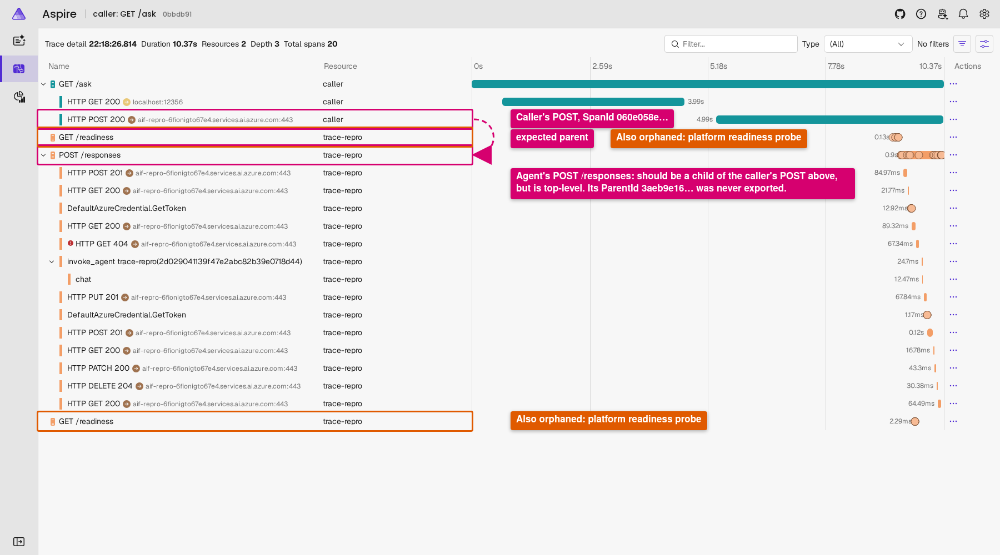
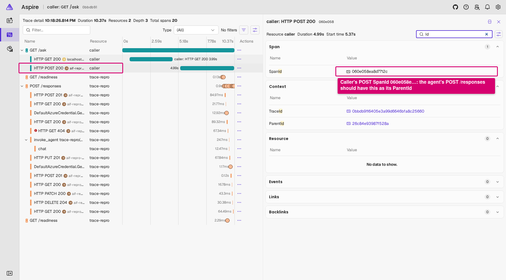
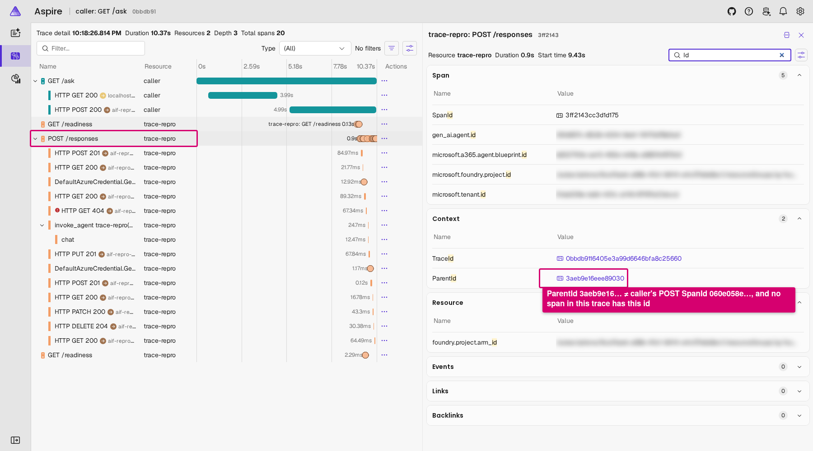
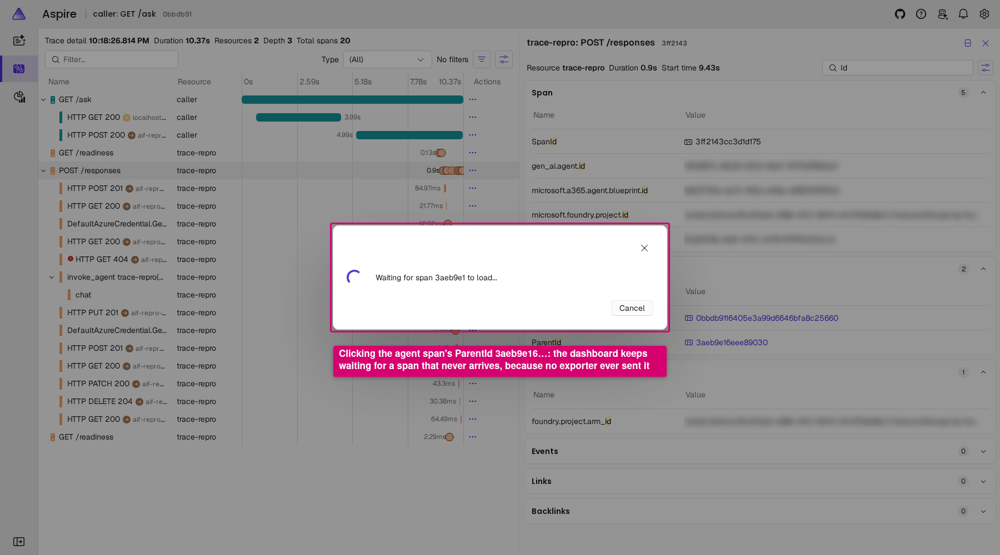
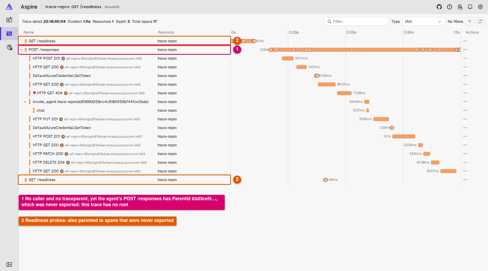

# foundry-trace-root-repro

Minimal reproduction: traces that pass through an Azure AI Foundry **hosted agent** have a missing parent span in any OTLP backend, and calls made without a caller trace have no root span at all.

## What it shows

A caller instrumented with OpenTelemetry calls a hosted agent (Responses protocol) through the project endpoint and sends a W3C `traceparent`. Foundry keeps the caller's trace id but replaces the parent span id with one of its own before the request reaches the agent container. That platform span is never exported over OTLP: the agent version's `OTEL_EXPORTER_OTLP_*` settings, as described in [Configure telemetry for hosted agents](https://learn.microsoft.com/en-us/azure/foundry/agents/how-to/configure-hosted-agent-telemetry), only cover the runtime inside the container. So the agent's `POST /responses` server span points at a parent that no exporter ever sends.

This repro has no Application Insights, so it cannot show where that parent goes. In a separate project with Application Insights monitoring enabled, in 28 of 28 sampled turns the agent's `POST /responses` parent was the platform's `agentsv2` `invoke_agent` span, and only Application Insights received it.

**Expected:** in an OTLP backend, the agent's `POST /responses` span is a child of the caller's outgoing `POST` span, or of a platform span that is exported to the same OTLP endpoint, so the trace is one connected tree. A call without a `traceparent` has a root span.

**Actual:** the agent's `POST /responses` span has the caller's trace id but a parent span id that appears nowhere in the exported telemetry. The same happens to the platform's readiness probes: each trace also holds two `GET /readiness` spans from the agent container, carrying the caller's trace id and each pointing at another parent that is never exported. So the Aspire Dashboard draws three orphaned top-level spans (`POST /responses` and two `GET /readiness`) beside the caller's `GET /ask`. A direct call without a `traceparent` produces a trace whose top-level spans, `POST /responses` and the same two `GET /readiness`, all still have parent ids, so the trace has no root.

The screenshots below are from this repro's Aspire Dashboard, with the annotations drawn on afterwards (subscription and tenant ids are blurred). They show one `GET /ask` (trace `0bbdb9116405e3a99d6646bfa8c25660`) and one direct call (trace `6bae895dd890bd60fe69b38f63c407e9`). The dashboard displays the caller's outgoing span, exported as `POST`, as `HTTP POST 200`.



*The `GET /ask` trace. `POST /responses` is a top-level row, not under the caller's `POST`, and the two `GET /readiness` rows are orphaned the same way.*



*The caller's `POST` has SpanId `060e058ea8d7712c`. This is the span the agent's `POST /responses` should be a child of.*



*The agent's `POST /responses` has ParentId `3aeb9e16eee89030`, which is not the caller's SpanId `060e058ea8d7712c`. No span in the trace has the id `3aeb9e16eee89030`.*



*Clicking that ParentId in the dashboard leaves it waiting for span `3aeb9e1…` indefinitely, because nothing ever exported a span with that id.*



*The direct call, made without a `traceparent`. `POST /responses` still has a parent (`83d3cef5a9188983`) that was never exported, so the trace has no root. The readiness probes are orphaned in the same way.*

Every span in the `GET /ask` trace, generated from the dashboard's telemetry API (`/api/telemetry/traces/0bbdb9116405e3a99d6646bfa8c25660`). The three ParentIds marked as not in trace are not the SpanId of any span the dashboard received:

| Span | Resource | SpanId | ParentId |
| --- | --- | --- | --- |
| `GET /ask` | caller | `26c84e93987f528a` | none (root) |
| `GET` | caller | `ef323da262189c86` | `26c84e93987f528a` |
| `POST` | caller | `060e058ea8d7712c` | `26c84e93987f528a` |
| `GET /readiness` | trace-repro | `03e9d016fd5c34e0` | **`f1fb19802a47b439` (not in trace)** |
| `POST /responses` | trace-repro | `3ff2143cc3d1d175` | **`3aeb9e16eee89030` (not in trace)** |
| `POST` | trace-repro | `86055a468482f492` | `3ff2143cc3d1d175` |
| `GET` | trace-repro | `5e17b7c420888b2c` | `3ff2143cc3d1d175` |
| `DefaultAzureCredential.GetToken` | trace-repro | `a5dd5b6a5426a786` | `3ff2143cc3d1d175` |
| `GET` | trace-repro | `0b17291f9c3b11f3` | `3ff2143cc3d1d175` |
| `GET /readiness` | trace-repro | `b4da6e303ada0ab2` | **`c294a851d7633d9c` (not in trace)** |
| `GET` | trace-repro | `8b2cf600bfb3397f` | `3ff2143cc3d1d175` |
| `invoke_agent trace-repro` | trace-repro | `6eee70acc455474c` | `3ff2143cc3d1d175` |
| `chat` | trace-repro | `33a6bc6947578176` | `6eee70acc455474c` |
| `PUT` | trace-repro | `ed72696ffe3b1e5a` | `3ff2143cc3d1d175` |
| `DefaultAzureCredential.GetToken` | trace-repro | `070350a8b03a4a68` | `3ff2143cc3d1d175` |
| `POST` | trace-repro | `d663c9d69021eae3` | `3ff2143cc3d1d175` |
| `GET` | trace-repro | `f4b561c1bbcf028d` | `3ff2143cc3d1d175` |
| `PATCH` | trace-repro | `c6248098735fc5ae` | `3ff2143cc3d1d175` |
| `DELETE` | trace-repro | `002f81c2edbe3fe1` | `3ff2143cc3d1d175` |
| `GET` | trace-repro | `a4e440628985c5e9` | `3ff2143cc3d1d175` |

Nothing in the agent changes how it extracts trace context. It is `AgentHost.CreateBuilder` with `AddFoundryResponses` and the SDK's default telemetry, the shape in [Foundry hosted agents](https://learn.microsoft.com/en-us/agent-framework/hosting/foundry-hosted-agent), answering a fixed reply so no model deployment is needed.

## What gets deployed

`infra/main.bicep`, into one resource group (no Application Insights, no Log Analytics, no project monitoring):

- A Foundry (AIServices) account with project management and one project, `trace-repro`.
- An Azure Container Registry the project's identity pulls from, linked to the project with an `acr` connection.
- A project `CustomKeys` connection, `otlp`, whose target is the dashboard's HTTPS URL and whose `headers` key holds `x-otlp-api-key=<key>`. The agent version refers to it as `${{connections.otlp.target}}` and `${{connections.otlp.credentials.headers}}`.
- A Container Apps environment without Log Analytics, and two apps in it:
  - **Aspire Dashboard** (`mcr.microsoft.com/dotnet/aspire-dashboard`), the only telemetry destination. UI, OTLP/HTTP and the telemetry API all share one HTTPS ingress. OTLP needs the `x-otlp-api-key` header, the UI needs a browser token, the API needs an `x-api-key`.
  - **Caller** (`caller/`), an ASP.NET Core app with OpenTelemetry tracing (ASP.NET Core and HttpClient instrumentation, OTLP exporter). `GET /ask` calls the hosted agent's Responses endpoint with its user-assigned managed identity.
- Role assignments: the caller's identity gets Foundry Agent Consumer on the project (to invoke the agent); whoever runs `deploy.sh` gets Foundry User on the project (to create agent versions).

The hosted agent (`agent/`) is created by `deploy.sh` through the Foundry REST API from `agent/agent-version.json`.

## Steps

Prerequisites: Azure CLI signed in to the tenant (`az login`), with rights to create a resource group and role assignments in the subscription; `jq` and `openssl`. No local Docker: images are built with `az acr build`.

```bash
SUBSCRIPTION=<subscription-id> ./deploy.sh
```

It registers the resource providers if needed, deploys the Bicep, builds and pushes both images, deploys the caller, creates the agent (or a new version of it) and waits for the version to become active. It ends by printing the dashboard URL, the caller URL and the agent's Responses endpoint. `RESOURCE_GROUP` (default `rg-foundry-root-repro`) and `LOCATION` (default `uksouth`, which must support hosted agents) can be overridden.

The generated keys live in `.repro.env` next to the scripts (git-ignored). To sign in to the dashboard, open `<dashboard URL>/login?t=<BROWSER_TOKEN from .repro.env>`.

Then:

1. **Through the caller:** `curl <caller URL>/ask`. The response is the agent's fixed reply.
2. **Directly, without a `traceparent`:**

   ```bash
   token=$(az account get-access-token --subscription "$SUBSCRIPTION" --resource https://ai.azure.com --query accessToken -o tsv)
   curl -X POST "<agent Responses endpoint>" -H "Authorization: Bearer $token" \
     -H "Content-Type: application/json" -d '{"input":"hello"}'
   ```

3. Open the dashboard's **Traces** page. The `caller: GET /ask` trace contains the caller's `GET /ask` and its child `POST` span (displayed as `HTTP POST 200`) and, as separate top-level spans, the agent's `POST /responses` and two `GET /readiness`. Select `POST /responses` and type `Id` in the details filter: its **ParentId** is not the caller's `POST` span id and is not the id of any span in the dashboard; the same holds for both `GET /readiness`. The direct call's trace has `POST /responses` and two `GET /readiness` as top-level spans with ParentIds that likewise match nothing.

To read the same thing as JSON from the dashboard's telemetry API (the list returns the newest 100 spans; `/api/telemetry/traces/<trace id>` returns one whole trace):

```bash
source .repro.env
curl -s -H "x-api-key: $DASHBOARD_API_KEY" "<dashboard URL>/api/telemetry/traces" |
  jq -r '.data.resourceSpans[] | (.resource.attributes[] | select(.key == "service.name").value.stringValue) as $service
         | .scopeSpans[].spans[] | [.traceId, $service, .name, .spanId, (.parentSpanId // "-")] | @tsv'
```

The dashboard keeps telemetry in memory, so it is lost if its single replica restarts.

To remove everything (the AIServices account is purged too, so its name is free again):

```bash
SUBSCRIPTION=<subscription-id> ./teardown.sh
```

## Versions

Run on 2026-10-25 in uksouth.

| Component | Version |
| --- | --- |
| Azure.AI.AgentServer.Core | 1.0.0-beta.29 (via Foundry.Hosting) |
| Azure.AI.AgentServer.Responses | 1.0.0-beta.8 (via Foundry.Hosting) |
| Microsoft.Agents.AI.Foundry.Hosting | 1.26.0-preview.261023.1 |
| Hosted agent protocol | responses 2.0.0, REST `api-version=v1` |
| OpenTelemetry (caller) | 1.18.0, ASP.NET Core instrumentation 1.15.2, HttpClient instrumentation 1.15.1 |
| .NET | 10.0 |
| Aspire Dashboard | 13.6.2 |
| Azure CLI / Bicep | 2.89.1 / 0.48.1 |
